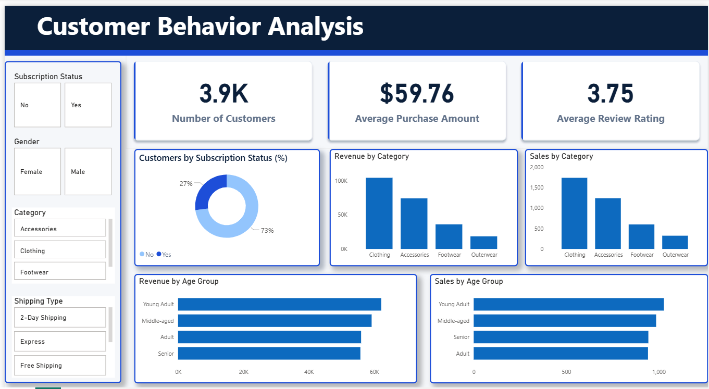

# Customer Behavior Analytics | Python, SQL, Power BI

## Project Overview
End-to-end analysis of 3,900 retail transactions to understand spending patterns, customer segments, product preferences and subscription behavior, and to support business decisions.

## Dataset
- *Rows:* 3,900 | *Columns:* 18
- *Customer details:* age, gender, location, subscription status
- *Purchase details:* item, category, purchase amount, season, size, color
- *Behavior:* discount applied, previous purchases, purchase frequency, review rating, shipping type
- *Missing data:* 37 values in review rating

## Tools Used
Python (Pandas, NumPy), SQL, Power BI (Power Query, DAX)

## Workflow
1. *Data cleaning (Python):* filled missing review ratings with the median rating of each product category, converted column names to snake case, created age_group and purchase frequency features, and dropped promo_code_used because it duplicated discount_applied.
2. *Business analysis (SQL):* revenue by gender, high-spending discount users, top-rated products, and more.
3. *Dashboard (Power BI):* KPI cards, subscription split, revenue by category and age group, with slicers for subscription status, gender, category and shipping type.

## Key Dashboard Metrics
- *3.9K* customers
- *$59.76* average purchase amount
- *3.75* average review rating

## Key Insights
- *Category:* Clothing generates the highest revenue, followed by Accessories, Footwear and Outerwear.
- *Subscriptions:* 27% of customers are subscribers and 73% are not. All subscribers are male (40% of male customers subscribe), and none of the female customers do.
- *Age group:* Young Adults generate the highest revenue (26.7% of the total), but revenue is spread fairly evenly across all age groups (Middle-aged 25.4%, Adult 24.0%, Senior 23.9%), so no single group dominates.
- *Gender:* Female and male customers spend about the same per purchase ($60.25 vs $59.54) and give the same ratings (3.74 vs 3.75). Men generate about 68% of revenue only because they are 68% of customers.

## Business Recommendations
- *Boost subscriptions:* design subscriber benefits and campaigns aimed at female customers, who currently have no subscribers.
- *Attract more female customers:* they spend as much per purchase as male customers, so growing this group is a clear revenue opportunity.
- *Customer loyalty programme:* reward repeat buyers.
- *Review discount policy:* balance sales boosts with margin control.
- *Product positioning:* highlight top-rated and best-selling products in campaigns.
- *Targeted marketing:* give Young Adults a slight priority as the top revenue group, while keeping campaigns for the other age groups, and focus on express-shipping users.

## Repository Structure
- Customer_behavior_analysis/Data/: dataset
- Customer_behavior_analysis/Notebook/: Python cleaning and EDA
- Customer_behavior_analysis/sql/: SQL business queries
- Customer_behavior_analysis/Dashboard/: Power BI file, preview image and PDF

## Author
*Aditi Shinde*: B.E. in AI & Data Science
www.linkedin.com/in/aditishinde18

